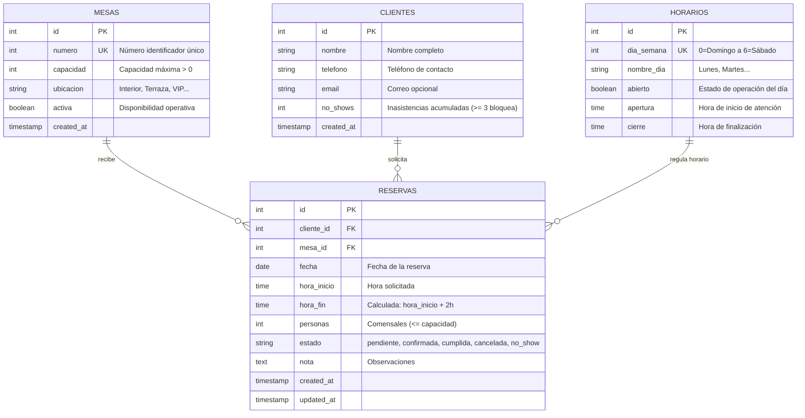

# GourmetReserve — Sistema Integral de Reservas de Restaurante con IA
> **Laboratorio #2 — Front End Development: React + Node.js + Base de Datos + Agente IA**  
> **Caso Seleccionado:** Caso 2 — Reservas de un restaurante con horarios reales  
> **Modalidad:** Proyecto Individual  
> **Directorio del Proyecto:** `2.backend/Laboratorio-2/`

---

## 1. DESCRIPCIÓN Y OBJETIVO GENERAL

**GourmetReserve** es una plataforma web full-stack de grado administrativo diseñada para gestionar de forma integral, segura y en tiempo real el ciclo de reservas de mesas en un restaurante.

El sistema resuelve los desafíos críticos de concurrencia y solapamiento de franjas horarias, garantiza el cumplimiento inquebrantable de los horarios de apertura y cierre semanales, implementa una duración fija estricta de 2 horas por reserva, administra un control automatizado de inasistencias (*no-shows*) con bloqueo preventivo, calcula métricas operativas mediante agregaciones SQL reales y se integra con un agente inteligente en **n8n** para interpretar solicitudes en lenguaje natural mediante consultas directas a la API REST.

---

## 2. ARQUITECTURA TÉCNICA

El sistema sigue una arquitectura por capas desacopladas con responsabilidades estrictamente delimitadas:

```mermaid
graph TD
    User([Usuario / Administrador]) -->|Interactúa con UI| Frontend[Frontend React + Vite :5174]
    Frontend -->|Fetch REST API| Backend[Backend Express :3000]
    Backend -->|pg Pool & Transacciones| DB[(PostgreSQL 17 :5432)]
    
    ClienteIA([Comensal Lenguaje Natural]) -->|Solicitud| Webhook[Webhook n8n :5678]
    Webhook --> AI_Agent[AI Agent LangChain]
    AI_Agent --> Gemini[Modelo Google Gemini LLM]
    AI_Agent -->|Herramienta HTTP| Backend
    Backend -->|Disponibilidad Real| AI_Agent
    AI_Agent -->|Contrato JSON| Webhook
    Webhook -->|Respuesta { ok, data, error }| Frontend
```

### Componentes de la Arquitectura
1. **Frontend (React 18 + Vite):**
   - Interfaz con diseño blanco y azul corporativo (`#F5F8FC`, `#2563EB`, `#1E3A8A`), sobria, accesible y responsive.
   - Navegación cliente mediante **React Router 6**.
   - Capa centralizada de comunicación en `src/services/api.js`.
   - Custom hook reactivo `useApi` para gestión de estados de carga, datos y errores.
   - Comprobador de disponibilidad de mesas en tiempo real antes de guardar.
2. **Backend (Node.js + Express):**
   - API REST modularizada en `routes/`, `controllers/`, `services/`, `middleware/`.
   - Gestión de conexiones con `pg.Pool` y transacciones ACID con `withTransaction`.
   - Bloqueo pesimista con `SELECT ... FOR UPDATE` para evitar condiciones de carrera simultáneas.
   - Manejador centralizado de excepciones con respuestas en formato `{ ok: false, error: "mensaje" }`.
3. **Base de Datos (PostgreSQL 17):**
   - Modelo relacional con integridad referencial (`ON DELETE RESTRICT`).
   - Restricciones `CHECK` para rangos positivos y duración obligatoria de 2 horas.
   - Índices para acelerar búsquedas por fecha, hora y mesa.
4. **Agente IA (n8n + Gemini):**
   - Flujo exportado en `workflow-n8n.json`.
   - Webhook en `/restaurante-ia`.
   - Agente LangChain que extrae parámetros (fecha, hora, personas, ubicación) y consulta la herramienta HTTP de disponibilidad.
   - Estandarización de salida al contrato superior `{ ok, data, error }`.

---

## 3. DIAGRAMA ENTIDAD-RELACIÓN



---

## 4. REGLAS DE NEGOCIO IMPLEMENTADAS EN EL SERVIDOR

Todas las reglas se validan en el backend; el frontend únicamente las refleja de forma preventiva.

| Regla | Descripción Técnica | Código HTTP en Conflicto |
| :--- | :--- | :--- |
| **Duración Fija (2 Horas)** | Cada reserva dura exactamente 2 horas. El servidor calcula `hora_fin = hora_inicio + 2h` y rechaza cualquier alteración enviada por el cliente. | `400 Bad Request` |
| **Horario de Operación** | La reserva debe encontrarse íntegramente dentro del horario de apertura del día correspondiente (`hora_inicio >= apertura` y `hora_fin <= cierre`). Si el día está marcado como cerrado, se rechaza. | `409 Conflict` |
| **Capacidad de Mesa** | La cantidad de personas debe ser mayor a 0 y menor o igual a la capacidad máxima de la mesa. No se admiten reservas en mesas inactivas (`activa = false`). | `409 Conflict` |
| **Solapamientos [inicio, fin)** | Dos reservas activas (`pendiente` o `confirmada`) para la misma mesa y fecha no pueden cruzarse en su intervalo semiabierto: `I1 < F2 AND F1 > I2`. Las consecutivas (ej. 18:00–20:00 y 20:00–22:00) sí se permiten. | `409 Conflict` |
| **Protección de Concurrencia** | El insert y update se ejecutan en transacciones PostgreSQL con bloqueo `FOR UPDATE` sobre la mesa para evitar que dos solicitudes simultáneas acepten la misma franja. | `409 Conflict` |
| **Control de Ausencias (No-Shows)** | Al pasar una reserva al estado `no_show`, se incrementa atómicamente en 1 el contador del cliente. Si acumula 3 o más ausencias, se rechaza cualquier nueva reserva. | `409 Conflict` |
| **Matriz de Transiciones** | Solo se permiten transiciones válidas: `pendiente → confirmada / cancelada / no_show` y `confirmada → cumplida / cancelada / no_show`. Estados terminales no se pueden modificar. | `409 Conflict` |
| **Métricas SQL Reales** | El endpoint `/api/resumen` calcula ocupación y distribución por estado mediante consultas agregadas `COUNT`, `SUM`, `GROUP BY` sobre PostgreSQL. | `200 OK` |

---

## 5. CATÁLOGO DE ENDPOINTS DE LA API REST

Todos los endpoints responden con formato JSON consistente:
- **Éxito:** `{ "ok": true, "data": ... }` con código HTTP 200 o 201.
- **Error:** `{ "ok": false, "error": "mensaje explicativo" }` con código HTTP 400, 404, 409 o 500.

### Mesas
- `GET /api/mesas` — Lista catálogo de mesas (filtros opcionales: `activa`, `ubicacion`, `capacidadMin`).
- `GET /api/mesas/:id` — Detalle de una mesa específica.
- `POST /api/mesas` — Registra una nueva mesa (`numero`, `capacidad`, `ubicacion`, `activa`).
- `PUT /api/mesas/:id` — Actualiza datos de una mesa.
- `DELETE /api/mesas/:id` — Elimina una mesa (rechazado con 409 si posee reservas asociadas).

### Clientes
- `GET /api/clientes` — Lista clientes (filtro por búsqueda: `search`).
- `GET /api/clientes/:id` — Detalle del cliente con estadísticas de reservas.
- `POST /api/clientes` — Registra un comensal (`nombre`, `telefono`, `email`).
- `PUT /api/clientes/:id` — Actualiza información de contacto (protegido contra manipulación manual de `no_shows`).
- `DELETE /api/clientes/:id` — Elimina un cliente si no tiene historial.

### Reservas
- `GET /api/reservas` — Lista reservas con joins a cliente y mesa (filtros: `fecha`, `estado`, `mesa_id`, `cliente_id`, `q`).
- `GET /api/reservas/:id` — Detalle completo relacionado.
- `POST /api/reservas` — Crea una reserva aplicando todas las reglas de negocio y transacciones.
- `PUT /api/reservas/:id` — Modifica fecha, mesa u horario revalidando disponibilidad y capacidad.
- `PATCH /api/reservas/:id/estado` — Aplica transición de estado (`estado: 'confirmada' | 'cumplida' | 'cancelada' | 'no_show'`).
- `DELETE /api/reservas/:id` — Elimina una reserva (protegido si está en `cumplida` o `no_show`).

### Horarios y Disponibilidad
- `GET /api/horarios` — Consulta horarios semanales de atención (días 0 al 6).
- `PUT /api/horarios/:id` — Actualiza apertura, cierre o estado de abierto del día.
- `GET /api/disponibilidad?fecha=YYYY-MM-DD&hora=HH:MM&personas=N&ubicacion=...` — Consulta mesas libres en tiempo real optimizadas por capacidad (mesa más pequeña con capacidad suficiente primero).
- `GET /api/resumen?fecha=YYYY-MM-DD` — Indicadores SQL agregados, distribución por estado y ocupación por franjas.
- `GET /api/health` — Comprobación de salud y estado de la API.

---

## 6. INSTALACIÓN Y PUESTA EN MARCHA

### 6.1 Requisitos Previos
- **Node.js** v18+ (instalado: v24.13.0)
- **npm** v9+ (instalado: 11.6.2)
- **PostgreSQL 17** (servicio `postgresql-x64-17` activo en puerto 5432)
- **n8n** (activo en puerto 5678)

### 6.2 Configuración de la Base de Datos
1. Configura tu contraseña de PostgreSQL en `backend/.env`:
   ```env
   DB_HOST=localhost
   DB_PORT=5432
   DB_USER=postgres
   DB_PASSWORD=tu_password_aqui
   DB_NAME=restaurante_reservas
   ```
2. Ejecuta el script de inicialización automática desde la carpeta `backend`:
   ```bash
   cd backend
   npm run init-db
   ```
   *Este comando crea la base de datos `restaurante_reservas`, ejecuta `schema.sql` y siembra los datos de prueba (mesas, clientes con ausencias, horarios semanales y reservas).*

### 6.3 Ejecución del Backend
Desde `backend/`:
```bash
npm start
```
El servidor arrancará en `http://localhost:3000`.

### 6.4 Ejecución del Frontend
Desde `frontend/`:
```bash
npm run dev
```
La aplicación web estará disponible en `http://localhost:5174` (o el puerto indicado en la consola).

---

## 7. CONFIGURACIÓN DEL AGENTE DE IA EN N8N

1. Abre la interfaz web de n8n en `http://localhost:5678`.
2. En el menú lateral, selecciona **Workflows** → **Import from File...** y selecciona el archivo `workflow-n8n.json` ubicado en la raíz de `Laboratorio-2/`.
3. Abre el nodo **Google Gemini Chat Model** y selecciona o crea tu credencial de API (Google AI Studio Gemini API Key).
4. Verifica que el nodo **Herramienta Consulta API** apunte a `http://localhost:3000/api/disponibilidad`.
5. Activa el workflow con el interruptor **Active**.
6. Desde la interfaz web en la vista **Asistente IA**, envía cualquier consulta como:
   > *"Quiero una mesa para cuatro personas el viernes a las ocho de la noche en la terraza"*

---

## 8. BATERÍA DE PRUEBAS AUTOMATIZADAS

Para validar la concurrencia y todas las reglas de negocio de extremo a extremo, ejecuta:
```bash
cd backend
npm run test-concurrency
```

### Resultados de la Batería
- **Prueba 1:** Cliente con 3 no-shows es rechazado con `HTTP 409`.
- **Prueba 2:** Exceso de capacidad de la mesa rechazado con `HTTP 409`.
- **Prueba 3:** Intento de reserva en mesa inactiva rechazado con `HTTP 409`.
- **Prueba 4:** Intento de reserva en día cerrado (Lunes) rechazado con `HTTP 409`.
- **Prueba 5:** Reserva que excede el horario de cierre rechazada con `HTTP 409`.
- **Prueba 6 (Concurrencia Simultánea):** Dos solicitudes en paralelo para la misma mesa y franja horaria: exactamente una es aceptada (`HTTP 201`) y la otra es rechazada por colisión (`HTTP 409`).
- **Prueba 7:** Reservas consecutivas en intervalo semiabierto (`16:00-18:00` y `18:00-20:00`) aceptadas exitosamente (`HTTP 201`).
- **Prueba 8:** Indicadores SQL de `/api/resumen` calculados correctamente.

---

## 9. GUÍA PARA LA DEFENSA INDIVIDUAL

### ¿Cómo se evita el solapamiento de reservas en el servidor?
Usamos intervalos semiabiertos `[hora_inicio, hora_fin)`. Dos reservas se solapan si `nueva_inicio < existente_fin AND nueva_fin > existente_inicio`. La verificación se realiza dentro de una transacción con `SELECT * FROM mesas WHERE id = $1 FOR UPDATE`, lo que serializa las solicitudes concurrentes para una misma mesa y previene condiciones de carrera (*race conditions*).

### ¿Cómo funciona el control de inasistencias (*no-shows*)?
Al marcar una reserva como `no_show` mediante `PATCH /api/reservas/:id/estado`, una transacción atómica actualiza el estado de la reserva e incrementa en 1 el campo `no_shows` del cliente. Si un cliente acumula 3 o más ausencias, el endpoint `POST /api/reservas` rechaza cualquier nueva solicitud con `HTTP 409 Conflict`.

### ¿Por qué la duración fija de 2 horas es inalterable?
El frontend no envía la hora final; únicamente envía `hora_inicio`. El backend calcula `hora_fin = addTwoHours(hora_inicio)` en el servidor y la base de datos cuenta con una restricción `CHECK (hora_fin = hora_inicio + INTERVAL '2 hours')`, garantizando la regla en ambas capas.

### ¿Qué rol juega el Agente de IA en n8n?
El agente interpreta el lenguaje natural para extraer fecha, hora, comensales y ubicación. Luego, ejecuta obligatoriamente la herramienta HTTP hacia la API REST (`/api/disponibilidad`) para comprobar mesas reales. La IA nunca inventa mesas ni confirma reservas directamente; la confirmación definitiva siempre la ejecuta el comensal en el sistema formal.
